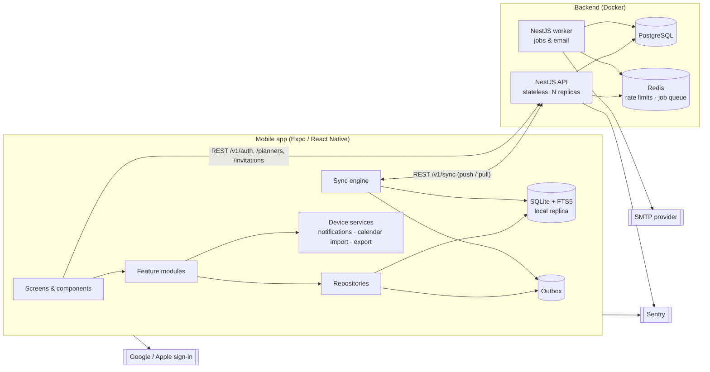

# System Architecture

Based strictly on [DECISIONS.md](../DECISIONS.md). Anything not settled there is listed in
[open-questions.md](open-questions.md) and marked **⟨Qn⟩** where it affects the design.

## 1. Overview

The app is **offline-first**: every device holds a full local replica of each planner the user
belongs to, and the server is the sync hub, the source of identity, and the place where
memberships and permissions live. While the server is down, everything works except the
server-only operations listed in DECISIONS §E (sign-in/up, invites, account deletion, admin).



## 2. Repository layout (monorepo)

```
weekly_calendar/
├─ apps/
│  ├─ mobile/            Expo app (TypeScript, expo-router)
│  └─ api/               NestJS app — two entry points: api (HTTP) and worker (jobs)
├─ packages/
│  └─ shared/            Shared domain package used by BOTH apps
├─ docker/               Dockerfiles
├─ docker-compose.yml    postgres, redis, api, worker, mailpit (local dev)
├─ docs/
└─ DECISIONS.md
```

pnpm workspaces + Turborepo for builds and tests.

### 2.1 `packages/shared` — the core of the offline design

Everything that has to behave the same on the device and on the server lives here, so it is
written once:

| Module | Responsibility |
|---|---|
| `schemas/` | Zod schemas for every entity and API DTO; length limits (focus = 200 chars; others ⟨Q1⟩). Used for app-side form validation, server-side request validation, and OpenAPI generation. |
| `week/` | Week boundaries for start day Mon or Sun; **canonical week key** (§5.3); the months a week spans (for the mini calendars). |
| `recurrence/` | Expands the basic presets (daily, weekdays, weekly on chosen days, monthly, yearly; until-date or count) into occurrences within a date range, then applies per-occurrence exceptions. ⟨Q7⟩ |
| `progress/` | Habit % (checked ÷ scheduled habit-days), weekly to-do % and daily task % (checked ÷ total), rounded to whole numbers. |
| `sync/` | Hybrid logical clock (HLC), per-field merge function, mutation/change types, deterministic ID helpers. |
| `ordering/` | Fractional-index position keys, so items can be reordered offline without renumbering. |

## 3. Backend (`apps/api`)

NestJS, organised by **clean architecture** inside each module:
`controller (HTTP) → application service (use cases) → domain (pure TS, mostly from shared) → repository (Drizzle/Postgres)`.

| Module | Responsibility |
|---|---|
| `auth` | Email + password (argon2id), Google and Apple ID-token verification (JWKS), email verification, password reset, JWT access tokens, rotating refresh tokens. |
| `users` | Profile, account deletion with a 30-day grace period (a login during the grace period cancels it). Blocks deletion while the user owns a household that has other members (ownership must be transferred first). |
| `planners` | Personal planner (created at sign-up), household planners, members and roles, ownership transfer, leaving or removing members. |
| `invitations` | Email invites and invite codes/links; accepting an invite creates a membership. ⟨Q11⟩ |
| `sync` | Push (applies per-field merges and checks permissions) and pull (cursor-based change feed). See §5. |
| `admin` | List users, disable or enable users, stats. Restricted to users with `is_admin`. ⟨Q13, Q14⟩ |
| `health` | `/healthz` (liveness), `/readyz` (database and Redis reachable). |
| `common` | Errors as RFC 9457 problem+json, request-ID middleware, pino JSON logger, Sentry, rate limiting. |

**Worker process** (same codebase, separate container; scheduled jobs use a Postgres advisory lock so only one instance runs each job):
- Sends emails from a BullMQ queue (verification, password reset, invites) over SMTP.
- Purges accounts once their 30-day deletion grace period has passed.
- Cleans up expired invitations, email tokens and refresh tokens.
- Compacts tombstones (deleted rows older than a retention window; clients that stay offline longer than that do a full re-sync).

**Scaling for thousands of users (D3).** The API is stateless (JWT, no server sessions in
memory), so you can run as many replicas as needed behind any load balancer. Rate-limit counters
live in Redis so they are shared across replicas. Postgres is a single primary; sync queries are
served by `(planner_id, server_seq)` indexes. Pushes are serialised **per planner**, never
globally (§5.4).

## 4. Mobile app (`apps/mobile`)

| Layer | Contents |
|---|---|
| `app/` (expo-router) | `(auth)/sign-in`, `sign-up`, `forgot-password`; `(app)/week/[weekKey]` (Week screen: mini calendars, habits, weekly to-dos, week note); `(app)/day/[date]` (swipe pager: focus, events, tasks, day note); `planners/` (switcher, household management, invites); `search`; `export`; `settings`. |
| `features/` | `habits`, `tasks`, `events`, `todos`, `focus`, `notes`, `households`; each has its hooks and components. |
| `data/` | **expo-sqlite** used directly (no ORM on the device); one repository per entity. Each write updates the local row and its field clocks and appends the change to the **outbox** in one SQLite transaction. FTS5 virtual table for search. |
| `sync/` | Sync engine: push the outbox, then pull. Triggered on app foreground, when connectivity is restored (NetInfo), after local writes (debounced), and on a periodic timer while open. |
| `services/` | `notifications` (expo-notifications), `deviceCalendar` (expo-calendar, read-only), `export` (expo-print for PDF, CSV/JSON files via expo-file-system and expo-sharing), `auth` (tokens in expo-secure-store). |
| `ui/` | Theme (pastel day colours, user-editable ⟨Q4⟩, light/dark variants), i18n (i18next, English strings externalised), locale-based 12h/24h time formatting. |

**Layouts (F1/F2).** Phones use a Week screen plus a day-to-day swipe pager. On wider screens
(≥ 768 dp, tablets in any orientation) a multi-column week appears: the left panel (calendars,
habits, to-dos) next to horizontally scrolling day columns, close to the spreadsheet look.

**Household viewers** see the same screens in read-only mode (no edit controls). The server
also enforces this on push.

### 4.1 Device-only features

| Feature | Design |
|---|---|
| **Search** (all text, all weeks) | SQLite FTS5 over the local replica, which holds every planner the user belongs to, so search works offline. There is no server search endpoint. |
| **Export** | Generated on the device, so it works offline. PDF of a week (an HTML template resembling the planner, rendered by expo-print), CSV, and a full JSON backup. ⟨Q16⟩ |
| **Device calendar import** (read-only) | expo-calendar reads events for the visible date range from the calendars the user picks in settings. They are displayed in the day columns, visually distinct, and are **never synced to the server**. |
| **Reminders** (local notifications) | Reminders are scheduled on each device from local data. iOS allows at most **64 pending local notifications**, so the scheduler keeps a rolling window: the next N reminder firings across all planners, recomputed after each sync, each local edit and each app foreground. Times are wall-clock in the device's current time zone. ⟨Q5, Q6⟩ |

## 5. Offline sync design

### 5.1 Identity of rows
- IDs are **UUIDv7, generated on the client**, so rows can be created offline.
- Rows that must be unique per key use **deterministic UUIDv5** IDs, so two offline devices
  that create "the same" row converge on one row instead of hitting a unique-constraint conflict:
  - `habit_check` = v5(habit_id, date)
  - `day_entry` (focus + day note) = v5(planner_id, date)
  - `week_note` = v5(planner_id, week_key)
  - `event_exception` = v5(event_id, original_date)
  - `habit_schedule` = v5(habit_id, effective_from)

### 5.2 Per-field merge (E2)
- Each device has a stable `node_id`. Every field write is stamped with a **hybrid logical clock**
  value: `"<13-digit ms>:<4-hex counter>:<node_id>"`. These strings sort lexicographically in
  causal order and never tie.
- Every synced row stores `field_clocks` (JSON: field → HLC). Deletion is the field `deleted`
  (a tombstone), so it merges like any other field.
- **Merge rule**, applied on both server and client: for each incoming field, apply it if
  `incoming_hlc > stored_hlc`. Edits to different fields from different devices or members
  therefore both survive, and for the same field the later edit wins.
- **Cross-field invariants** (e.g. end time after start time, all-day events have no times) are
  checked on the **merged** row. If a mutation would produce an invalid merged row, the server
  rejects it, and the client discards its local version and takes the server row.

### 5.3 Canonical week key
Weekly items (weekly to-dos, week note) are keyed by the **Monday that falls inside the
displayed week**. A Monday-start week contains its Monday as day 1 and a Sunday-start week
contains it as day 2, so the key is unique in both conventions. If a planner switches between
Monday and Sunday start, no data migration is needed: each week's to-dos and note move with it,
and the week boundary just shifts by one day. Day-level data is keyed by calendar date and is
unaffected.

### 5.4 Server sequence and change feed
- Each planner row holds a counter `seq_counter`. A push transaction runs
  `UPDATE planners SET seq_counter = seq_counter + k … RETURNING` first. This locks the planner
  row until commit, so sequence numbers within a planner are assigned **and committed in order**.
  That avoids the classic "skipped change" bug with global sequences under concurrent commits.
  Pushes to different planners never block each other.
- Each changed row gets `server_seq` = its planner's next number.
- **Pull** sends `cursors: {planner_id: last_seq}`. The server returns rows with
  `server_seq > cursor` per planner, in pages. It also returns the current membership snapshot,
  so the device can drop planners it no longer has access to.

### 5.5 Client flow
```
local edit → SQLite txn { update row + field_clocks, append outbox entry }
sync tick  → POST /sync/push (outbox batch, ≤ 500 mutations)
           → server merges, returns accepted / rejected (+ authoritative rows)
           → client clears accepted outbox entries, adopts server rows for rejected ones
           → POST /sync/pull (cursors) until hasMore = false → merge into SQLite → reschedule reminders
```
Tokens: an expired access token is refreshed before syncing. If refresh fails, the app keeps
working offline and asks the user to sign in again; the outbox is kept.

## 6. Cross-cutting concerns

| Concern | Approach |
|---|---|
| Validation | Zod schemas from `shared`, applied in mobile forms and at the API boundary (nestjs-zod). |
| Errors | RFC 9457 `application/problem+json` with a stable `code` field the app maps to localised messages. |
| Logging (G1) | pino JSON to stdout with request ID, user ID and route; no secrets or note contents in logs. Sentry on API, worker and mobile. |
| Security | argon2id password hashing; 15-min JWT access tokens; rotating refresh tokens stored hashed, with token-reuse detection that revokes the whole token family; rate limits on auth endpoints; CORS closed (mobile only); HTTPS terminated at the deployment's load balancer. |
| Time (wall-clock) | Event dates and times are stored without a time zone (`date` and `time` columns) and shown as entered. Server timestamps (`created_at` etc.) are `timestamptz` UTC. |
| Testing (G2) | Unit tests with Jest for `shared` (recurrence, week math, merge, progress), API services and mobile repositories. Integration tests: the API against a real Postgres in Docker (Testcontainers), including sync convergence scenarios. |
| Store readiness (D2) | Sign in with Apple, in-app account deletion and a privacy manifest are in from the start. EAS Build/Submit for internal tracks first. |
