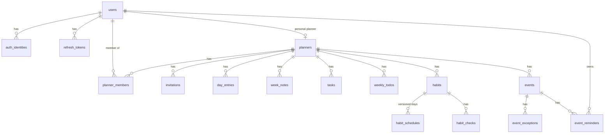

# Database Schema (PostgreSQL)

Server schema. The mobile SQLite replica mirrors the **planner content** tables (§3) with the
same columns, minus `server_seq`, plus an `outbox` table. Items marked **⟨Qn⟩** depend on
[open-questions.md](open-questions.md); the DDL shows the proposed answer.

Migrations: drizzle-kit, one SQL migration per change, run by the API container on start-up
(guarded by an advisory lock).

## 1. Conventions

- Primary keys are `uuid`, generated by the client (UUIDv7, or UUIDv5 for deterministic rows; see architecture §5.1).
- Server timestamps are `timestamptz` (UTC). User-facing event dates and times are `date` / `time` (wall-clock, no zone).
- Every **synced** table has these columns:

| Column | Type | Purpose |
|---|---|---|
| `planner_id` | uuid FK → planners | Scope for permissions and the change feed |
| `server_seq` | bigint | Position in the planner's change feed |
| `field_clocks` | jsonb | `{field: hlc}` for per-field merge |
| `deleted` | boolean | Tombstone (merged like a field) |
| `created_at`, `updated_at` | timestamptz | Server bookkeeping |

  …plus the index `(planner_id, server_seq)`.
- Weekday bitmask: bit 0 = Monday … bit 6 = Sunday (ISO order), valid range 1–127.
- Ordering: `position text` holds fractional-index keys (sorted with `COLLATE "C"`).
- Text length limits: `focus` = 200 (confirmed). Other limits ⟨Q1⟩ are shown as the proposed 200 for titles/names and 10 000 for notes.

## 2. Identity and access

```sql
CREATE EXTENSION IF NOT EXISTS citext;

CREATE TABLE users (
  id                      uuid PRIMARY KEY,
  email                   citext NOT NULL UNIQUE,
  email_verified_at       timestamptz,
  password_hash           text,                       -- null for social-only accounts
  display_name            varchar(60),                -- ⟨Q3⟩ optional, falls back to email
  is_admin                boolean NOT NULL DEFAULT false,
  disabled_at             timestamptz,                -- set by admin
  deletion_scheduled_for  timestamptz,                -- now() + 30 days; cleared on login
  last_login_at           timestamptz,
  created_at              timestamptz NOT NULL DEFAULT now(),
  updated_at              timestamptz NOT NULL DEFAULT now()
);
CREATE INDEX users_deletion_due ON users (deletion_scheduled_for) WHERE deletion_scheduled_for IS NOT NULL;

CREATE TABLE auth_identities (                         -- Google / Apple links
  id                uuid PRIMARY KEY,
  user_id           uuid NOT NULL REFERENCES users(id) ON DELETE CASCADE,
  provider          text NOT NULL CHECK (provider IN ('google','apple')),
  provider_subject  text NOT NULL,                     -- the provider's stable "sub"
  email             citext,                            -- as asserted by provider (may be Apple relay)
  created_at        timestamptz NOT NULL DEFAULT now(),
  UNIQUE (provider, provider_subject)
);
CREATE INDEX auth_identities_user ON auth_identities (user_id);

CREATE TABLE refresh_tokens (
  id            uuid PRIMARY KEY,
  user_id       uuid NOT NULL REFERENCES users(id) ON DELETE CASCADE,
  family_id     uuid NOT NULL,                         -- rotation chain; reuse ⇒ revoke family
  token_hash    bytea NOT NULL UNIQUE,                 -- SHA-256 of the opaque token
  device_label  varchar(100),
  expires_at    timestamptz NOT NULL,
  revoked_at    timestamptz,
  replaced_by   uuid REFERENCES refresh_tokens(id),
  created_at    timestamptz NOT NULL DEFAULT now(),
  last_used_at  timestamptz
);
CREATE INDEX refresh_tokens_user ON refresh_tokens (user_id);
CREATE INDEX refresh_tokens_family ON refresh_tokens (family_id);

CREATE TABLE email_tokens (                            -- verification & password reset
  id          uuid PRIMARY KEY,
  user_id     uuid NOT NULL REFERENCES users(id) ON DELETE CASCADE,
  purpose     text NOT NULL CHECK (purpose IN ('verify_email','reset_password')),
  token_hash  bytea NOT NULL UNIQUE,
  expires_at  timestamptz NOT NULL,
  used_at     timestamptz,
  created_at  timestamptz NOT NULL DEFAULT now()
);
```

## 3. Planners and membership

```sql
CREATE TABLE planners (
  id                 uuid PRIMARY KEY,
  kind               text NOT NULL CHECK (kind IN ('personal','household')),
  personal_owner_id  uuid UNIQUE REFERENCES users(id) ON DELETE CASCADE, -- set only for kind='personal'
  name               varchar(60),                      -- ⟨Q2⟩ required for households
  week_start_day     smallint NOT NULL DEFAULT 1 CHECK (week_start_day IN (1,7)), -- ISO: 1=Mon, 7=Sun
  day_colors         jsonb NOT NULL DEFAULT '{}',      -- ⟨Q4⟩ {"1":"#F6C89F",…,"7":"…"}; empty = theme defaults
  seq_counter        bigint NOT NULL DEFAULT 0,        -- change-feed allocator (row-locked on push)
  -- planner settings (name, week_start_day, day_colors) sync with per-field merge:
  server_seq         bigint NOT NULL DEFAULT 0,
  field_clocks       jsonb NOT NULL DEFAULT '{}',
  deleted_at         timestamptz,                      -- household deleted by owner
  created_at         timestamptz NOT NULL DEFAULT now(),
  updated_at         timestamptz NOT NULL DEFAULT now(),
  CHECK ((kind = 'personal') = (personal_owner_id IS NOT NULL)),
  CHECK (kind = 'personal' OR name IS NOT NULL)
);

CREATE TABLE planner_members (
  planner_id  uuid NOT NULL REFERENCES planners(id) ON DELETE CASCADE,
  user_id     uuid NOT NULL REFERENCES users(id) ON DELETE CASCADE,
  role        text NOT NULL CHECK (role IN ('owner','editor','viewer')),
  joined_at   timestamptz NOT NULL DEFAULT now(),
  PRIMARY KEY (planner_id, user_id)
);
CREATE UNIQUE INDEX planner_one_owner ON planner_members (planner_id) WHERE role = 'owner';
CREATE INDEX planner_members_user ON planner_members (user_id);
-- A personal planner has exactly one member: its owner (enforced in the service layer).

CREATE TABLE invitations (                             -- ⟨Q11⟩ rules shown as proposed
  id           uuid PRIMARY KEY,
  planner_id   uuid NOT NULL REFERENCES planners(id) ON DELETE CASCADE,
  kind         text NOT NULL CHECK (kind IN ('email','code')),
  email        citext,                                 -- kind='email' only
  secret_hash  bytea NOT NULL UNIQUE,                  -- hash of link token or invite code
  role         text NOT NULL CHECK (role IN ('editor','viewer')),
  created_by   uuid NOT NULL REFERENCES users(id) ON DELETE CASCADE,
  expires_at   timestamptz NOT NULL,
  accepted_by  uuid REFERENCES users(id) ON DELETE SET NULL,  -- email invites: single use
  accepted_at  timestamptz,
  revoked_at   timestamptz,
  created_at   timestamptz NOT NULL DEFAULT now(),
  CHECK ((kind = 'email') = (email IS NOT NULL))
);
CREATE INDEX invitations_planner ON invitations (planner_id);
```

## 4. Planner content (synced)

> **Targets update (migrations 0002–0003, DECISIONS J1–J16).** `habit_checks` was replaced by
> **`completions`** (`id, item_type IN (habit, weekly_todo, task), item_id, date` + sync columns; one row per tap,
> index `(item_id, date)`). `habit_schedules` and `weekly_todos` gained `target_type, per_day, days_per_week,
> times_per_week` with CHECKs mirroring `targetIssues`; `tasks` gained `per_day` (1–20) and `span_days` (2–31);
> `habits` gained `hide_when_achieved`. The DDL below shows the original schema; `apps/api/src/database/schema` is current.

The common sync columns from §1 are written out as `/* sync cols */` to keep the DDL readable:

```sql
-- /* sync cols */ =
--   planner_id uuid NOT NULL REFERENCES planners(id) ON DELETE CASCADE,
--   server_seq bigint NOT NULL, field_clocks jsonb NOT NULL DEFAULT '{}',
--   deleted boolean NOT NULL DEFAULT false,
--   created_at timestamptz NOT NULL DEFAULT now(), updated_at timestamptz NOT NULL DEFAULT now()
```

### 4.1 Days and weeks

```sql
CREATE TABLE day_entries (                 -- id = v5(planner_id, date)
  id     uuid PRIMARY KEY,
  date   date NOT NULL,
  focus  varchar(200),                     -- "Today's focus", single line (A5)
  note   varchar(10000),                   -- per-day note (A10)
  /* sync cols */
  UNIQUE (planner_id, date)
);

CREATE TABLE week_notes (                  -- id = v5(planner_id, week_key)
  id        uuid PRIMARY KEY,
  week_key  date NOT NULL CHECK (extract(isodow FROM week_key) = 1), -- canonical Monday
  body      varchar(10000),
  /* sync cols */
  UNIQUE (planner_id, week_key)
);
```

### 4.2 Daily tasks and weekly to-dos

```sql
CREATE TABLE tasks (
  id        uuid PRIMARY KEY,
  date      date NOT NULL,                 -- changing it = "move to another day" (A7)
  title     varchar(200) NOT NULL,
  done      boolean NOT NULL DEFAULT false,
  position  text COLLATE "C" NOT NULL,     -- reorder within the day (A7)
  /* sync cols */
);

CREATE TABLE weekly_todos (                -- no carry-over (A4)
  id        uuid PRIMARY KEY,
  week_key  date NOT NULL CHECK (extract(isodow FROM week_key) = 1),
  title     varchar(200) NOT NULL,
  done      boolean NOT NULL DEFAULT false,
  position  text COLLATE "C" NOT NULL,
  /* sync cols */
);
```

### 4.3 Habits

A habit persists across weeks (A3). Edits apply going forward, so the **schedule is versioned**
and a habit has an active range. Past weeks keep the schedule that applied to them.
⟨Q9⟩ covers renaming and removal.

```sql
CREATE TABLE habits (
  id         uuid PRIMARY KEY,
  name       varchar(200) NOT NULL,        -- ⟨Q9⟩ proposed: not versioned (rename shows everywhere)
  position   text COLLATE "C" NOT NULL,
  starts_on  date NOT NULL,                -- week_key of the week it was created
  ends_on    date,                         -- ⟨Q9⟩ "stop tracking": last week_key it appears in
  /* sync cols */
);

CREATE TABLE habit_schedules (             -- id = v5(habit_id, effective_from)
  id              uuid PRIMARY KEY,
  habit_id        uuid NOT NULL REFERENCES habits(id) ON DELETE CASCADE,
  effective_from  date NOT NULL CHECK (extract(isodow FROM effective_from) = 1), -- week_key
  weekdays        smallint NOT NULL CHECK (weekdays BETWEEN 1 AND 127),
  /* sync cols */
  UNIQUE (habit_id, effective_from)
);
-- Schedule for a week = the row with the greatest effective_from <= that week_key.

CREATE TABLE habit_checks (                -- id = v5(habit_id, date); household: one shared check (C3)
  id        uuid PRIMARY KEY,
  habit_id  uuid NOT NULL REFERENCES habits(id) ON DELETE CASCADE,
  date      date NOT NULL,
  checked   boolean NOT NULL,
  /* sync cols */
  UNIQUE (habit_id, date)
);
```

### 4.4 Events

```sql
CREATE TABLE events (
  id                   uuid PRIMARY KEY,
  title                varchar(200) NOT NULL,
  start_date           date NOT NULL,            -- first occurrence
  all_day              boolean NOT NULL DEFAULT false,
  start_time           time,                     -- wall-clock
  end_time             time,                     -- optional (A6); ⟨Q8⟩ same day, after start
  recurrence_freq      text CHECK (recurrence_freq IN ('daily','weekdays','weekly','monthly','yearly')),
  recurrence_weekdays  smallint CHECK (recurrence_weekdays BETWEEN 1 AND 127), -- weekly only
  recurrence_until     date,
  recurrence_count     integer CHECK (recurrence_count > 0),
  /* sync cols */
  CHECK (all_day = (start_time IS NULL)),
  CHECK (NOT all_day OR end_time IS NULL),
  CHECK (end_time IS NULL OR end_time > start_time),
  CHECK ((recurrence_freq = 'weekly') = (recurrence_weekdays IS NOT NULL)),
  CHECK (recurrence_until IS NULL OR recurrence_count IS NULL),
  CHECK (recurrence_freq IS NOT NULL OR (recurrence_until IS NULL AND recurrence_count IS NULL))
);
-- Monthly/yearly repeat on start_date's day-of-month / month+day. ⟨Q7⟩ for 29–31 Feb.

CREATE TABLE event_exceptions (            -- edit/delete "this occurrence"; id = v5(event_id, original_date)
  id             uuid PRIMARY KEY,
  event_id       uuid NOT NULL REFERENCES events(id) ON DELETE CASCADE,
  original_date  date NOT NULL,            -- which occurrence is replaced
  cancelled      boolean NOT NULL DEFAULT false,
  -- full snapshot of the occurrence (not partial overrides, so "clear end time" is expressible):
  title          varchar(200),
  date           date,
  all_day        boolean,
  start_time     time,
  end_time       time,
  /* sync cols */
  UNIQUE (event_id, original_date),
  CHECK (cancelled OR (title IS NOT NULL AND date IS NOT NULL AND all_day IS NOT NULL))
);
-- "Edit all" changes the events row; occurrences that already have an exception keep their snapshot.

CREATE TABLE event_reminders (             -- multiple, custom offsets (A6); scheduled locally on devices
  id              uuid PRIMARY KEY,
  event_id        uuid NOT NULL REFERENCES events(id) ON DELETE CASCADE,
  user_id         uuid NOT NULL REFERENCES users(id) ON DELETE CASCADE, -- ⟨Q5⟩ proposed: reminders are personal
  offset_minutes  integer NOT NULL CHECK (offset_minutes >= 0),          -- minutes before start; ⟨Q6⟩ all-day anchor
  /* sync cols */
);
```

### 4.5 Indexes on synced tables

```sql
-- For every synced table T (planners included):
CREATE INDEX T_feed ON T (planner_id, server_seq);
-- Child lookups:
CREATE INDEX habit_schedules_habit ON habit_schedules (habit_id);
CREATE INDEX event_exceptions_event ON event_exceptions (event_id);
CREATE INDEX event_reminders_event ON event_reminders (event_id);
```

The server never queries content by date: the device does all date-range queries on its local
replica, so the change-feed index is the hot path.

## 5. Mobile-only tables (SQLite)

```sql
CREATE TABLE outbox (                      -- pending local mutations
  seq          INTEGER PRIMARY KEY AUTOINCREMENT,
  entity_type  TEXT NOT NULL,
  entity_id    TEXT NOT NULL,
  planner_id   TEXT NOT NULL,
  fields       TEXT NOT NULL,              -- JSON {field: value}
  clocks       TEXT NOT NULL,              -- JSON {field: hlc}
  created_at   TEXT NOT NULL
);
CREATE TABLE sync_state (planner_id TEXT PRIMARY KEY, cursor INTEGER NOT NULL);
CREATE TABLE kv (key TEXT PRIMARY KEY, value TEXT); -- node_id, HLC state, device calendar selection, theme
CREATE VIRTUAL TABLE search_index USING fts5(entity_type, entity_id UNINDEXED, planner_id UNINDEXED, ref_date UNINDEXED, text);
```

## 6. Entity relationships



## 7. Lifecycle rules

| Event | Effect |
|---|---|
| Sign-up | Create `users`, a personal `planners` row and an owner `planner_members` row in one transaction. |
| Request account deletion | Rejected (409) if the user owns a household with other members. Otherwise `deletion_scheduled_for = now() + 30 days` and all refresh tokens are revoked. |
| Login during the grace period | `deletion_scheduled_for = NULL`. |
| Purge (worker) | Delete households where the user is the only member, then delete the `users` row (cascades: personal planner, memberships, reminders, tokens). Content the user created in shared households stays. |
| Owner deletes a household | `deleted_at` set; memberships removed; members' devices drop it on the next pull; hard-deleted by the worker after the tombstone retention window. |
| Member removed / leaves | Membership row deleted; the device drops the planner on the next pull. The owner can't leave without transferring ownership first. |
